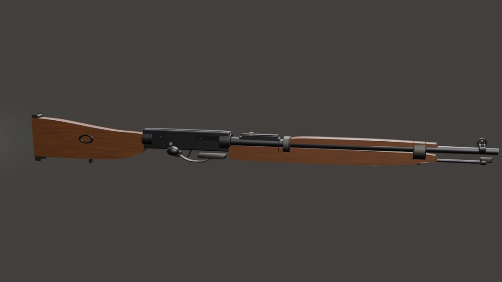
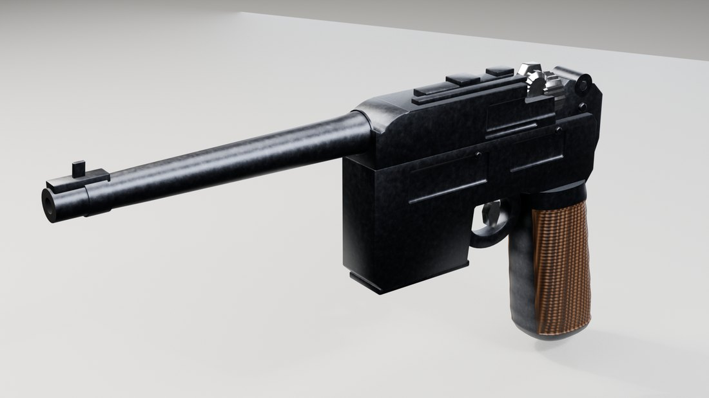

<div align="center">

# Blender 3D Modeling Workshop

**Any coding agent opened in this folder becomes a Blender artist.**

It takes a request, builds the model in Blender over MCP, renders it, exports it,
and then proves the result with a script that re-measures the files on disk.

<sub>Blender 5.2 LTS · Blender MCP v1.0.3 · 3 models · 3/3 audit PASS · MIT</sub>

</div>

<table>
<tr>
<td align="center" width="33%">
<a href="models/mosin-nagant-m91-30/NOTES.md"></a>
<br><sub><b>Mosin-Nagant M91/30</b><br>25,940 tris</sub>
</td>
<td align="center" width="33%">
<a href="models/mauser-c96-original/NOTES.md"></a>
<br><sub><b>Mauser C96</b><br>33,277 tris</sub>
</td>
<td align="center" width="33%">
<a href="models/golden-desert-eagle/NOTES.md"></a>
<br><sub><b>Golden Desert Eagle</b><br>25,458 tris</sub>
</td>
</tr>
</table>

## Why this exists

Most AI-generated 3D work is unverifiable. The agent says the rifle is 1.2 m long and
25,000 triangles, and nothing checks whether that is true — or whether the render it shows
you came from that file at all.

Here the claim and the file have to agree, and a script decides. Every model ships with a
`NOTES.md` that records what was measured, what was corrected when an earlier claim turned
out wrong, and what is still missing. Then `verify_model.py` re-opens the exports and fails
the delivery if any of it has drifted.

## The auditor

```bash
python scripts/verify_model.py --all
```

```
Model: mauser-c96-original
  [ OK ] exports/<slug>.glb — 0.99 MiB — 33,277 tris, 17 meshes, 4 materials,
                              0 textures, 0.2865 x 0.1538 x 0.0368 m
  [ OK ] exports/<slug>.fbx — 0.87 MiB — 17 SM_ meshes, UCX_=8, COL_=0
  [ OK ] collision — 4 UCX proxies (FBX)
RESULT: PASS

SUMMARY: 3/3 model(s) PASS
```

It parses the GLB for triangles, world-space bounds, meshes, materials and embedded textures;
scans the FBX for `UCX_`/`COL_` collision; checks that every render is a real, non-blank
image rather than a viewport grab; and compares all of it against the `<!-- verify:begin -->`
block in each record. Exit code 1 means the record and the files disagree.

## How a model gets built

| Step | What happens |
|---|---|
| **1 · Scaffold** | `python scripts/new_model.py <slug>` creates `models/<slug>/` and a brief skeleton |
| **2 · Plan** | A parts manifest is written before any geometry: every sub-part, its measured dimensions, its tri budget, its detail spec |
| **3 · Build** | Parts are built in dependency order, one per MCP call, each passing its own gate — measured dimensions, programmatically counted details, an inspected close-up render |
| **4 · Assemble** | UVs, materials, lights, hero and detail renders |
| **5 · Export** | GLB + FBX from a duplicate of the scene, then a GLB re-import round-trip |
| **6 · Prove** | `verify_model.py` re-measures everything; the delivery is not done until it passes |

The part-first loop is the part that matters. A model is not finished because the hero shot
looks right — it is finished when each part is measurably correct on its own.

## The models

| Model | Subject | Tris | Materials | Collision | Deliverables |
|---|---|---|---|---|---|
| **[Mosin-Nagant M91/30](models/mosin-nagant-m91-30/NOTES.md)** | WW2 bolt-action rifle | 25,940 | 5 (3 baked) | 4 `UCX_` | [hero](models/mosin-nagant-m91-30/renders/hero.png) · GLB 5.1 MB · FBX 4.8 MB |
| **[Mauser C96](models/mauser-c96-original/NOTES.md)** | 1896 semi-automatic pistol | 33,277 | 4 | 4 `UCX_` | [hero](models/mauser-c96-original/renders/hero.png) · GLB 1.0 MB · FBX 0.9 MB |
| **[Golden Desert Eagle](models/golden-desert-eagle/NOTES.md)** | .50 AE pistol, gold titanium | 25,458 | 5 | none — render-only | [hero](models/golden-desert-eagle/renders/hero_34.png) · GLB 0.7 MB · FBX 0.5 MB |

Each folder holds an editable `.blend`, the exports, the full render set, the references used,
and the `bpy` scripts that were actually executed.

The known-gaps sections are deliberate and public: no engine import has been run on any of the
three, none ships an LOD chain, and the Desert Eagle's materials are procedural and flatten on
export instead of shipping a baked texture set. Closing those is the work that remains.

## Quick start

```bash
python scripts/preflight.py        # check Blender, the MCP extension, the client, the bridge
```

Expect `RESULT: READY`. Open Blender, leave it running, then open this folder in your agent
and ask for a model in plain language:

> Make a realistic WW2 rifle, game-ready for Unreal

<details>
<summary><b>Requirements</b></summary>

| Piece | What you need |
|---|---|
| Blender | 5.2 LTS — built and tested on 5.2.3 |
| MCP extension | Official Blender Lab **MCP** add-on v1.0.3, enabled with Auto Start |
| MCP client | Official `blender-mcp` 1.30.0 as a `uv tool` (26 tools) |
| Skill pack | 94 skills + 9 shared references in `.claude/skills/` (mirror in `.cursor/skills/`) |
| MCP configs | `.mcp.json` (Claude Code), `.cursor/mcp.json` (Cursor), `.vscode/mcp.json` |

```
Blender 5.2  ⇐  MCP extension (localhost:9876)  ⇐  blender-mcp (stdio)  ⇐  your agent
```

If the client or extension is missing on another machine:

```bash
uv tool install --python 3.11 \
  "git+https://projects.blender.org/lab/blender_mcp.git#subdirectory=mcp"
```

…and install the extension from <https://www.blender.org/lab/mcp-server/>. Details in
[`docs/MCP_SETUP.md`](docs/MCP_SETUP.md).

</details>

<details>
<summary><b>Repository map</b></summary>

| Path | Purpose |
|---|---|
| `AGENTS.md` | **The manual.** Scope, preflight, routing, pipeline, deliverables, rules |
| `CLAUDE.md` | Claude Code entry point → `AGENTS.md` |
| `.cursor/rules/blender-workshop.mdc` | Always-on Cursor rule → `AGENTS.md` |
| `.claude/skills/` | 94 skills (`*/SKILL.md`) + `references/` (pipeline, naming, budgets) |
| `.cursor/skills/` | Mirror of the pack for Cursor |
| `scripts/preflight.py` | Checks Blender, extension, client, configs, bridge identity, live socket |
| `scripts/new_model.py` | Creates a standard model folder + brief skeleton |
| `scripts/verify_model.py` | Audits a delivery against its own record (`--all` for every model) |
| `scripts/mcp_call.py` | Fallback MCP stdio client for hosts with no MCP tools loaded |
| `models/` | All output, one folder per model |
| `docs/MCP_SETUP.md` | Official MCP chain, tool catalog, install commands |
| `docs/SKILLS_GUIDE.md` | Upstream skill index and workflows |

Per model:

```
models/<slug>/
├── NOTES.md          # brief, detail spec, gate evidence, QA verdict
├── <slug>.blend      # editable Blender scene
├── versions/         # gate snapshots (_v01_blockout … _v04_export)
├── refs/             # reference images / dimensions
├── renders/          # hero + front/side/top + detail close-ups
├── textures/         # baked maps used by the exports
├── scripts/          # the bpy code that was actually run
└── exports/          # <slug>.glb, <slug>.fbx
```

</details>

<details>
<summary><b>Ground rules</b></summary>

- One request → one folder. Existing models are never overwritten.
- Real-world scale: 1 Blender unit = 1 meter.
- Execute in Blender; never hand back UI instructions or unexecuted code as if it ran.
- Save the `.blend` at every phase gate — versioned snapshots, not one overwritten file.
- Identity detail (lettering, marks, counted grooves and serrations) is modelled before UVs —
  never a blank panel where a rollmark belongs.
- One part at a time, one phase per MCP call. A part passes its gate before the next begins.
- If the bridge wedges, stop and report rather than silently switching to `blender --background`.
- Invalid evidence is quarantined, not deleted — a blank render moves to
  `renders/_invalid_evidence/` and the record says why.

</details>

<details>
<summary><b>Troubleshooting</b></summary>

| Symptom | Fix |
|---|---|
| `RESULT: BLOCKED` / nothing on 9876 | Enable the MCP extension and press **Start MCP Bridge Server** |
| MCP server missing in the client | Restart the client; check your client's config file |
| `blender-mcp` not found | `uv tool install --python 3.11 "git+https://projects.blender.org/lab/blender_mcp.git#subdirectory=mcp"` |
| Handshake errors / hanging calls | Wrong server package or the legacy `blender_mcp.py` addon enabled — see `docs/MCP_SETUP.md` |
| Renders look wrong | Ask the agent to re-check camera/engine and re-render; renders come from the scene, not the agent's imagination |

</details>

<details>
<summary><b>Updating the skill pack</b></summary>

The pack is vendored (MIT). To refresh it:

```bash
git clone --depth 1 https://github.com/arjun988/blender-skills.git .upstream
cp -r .upstream/.claude/skills/. .claude/skills/
cp -r .upstream/.claude/skills/. .cursor/skills/
cp .upstream/SKILLS_GUIDE.md docs/
cp .upstream/LICENSE docs/blender-skills-LICENSE.md
rm -rf .upstream
python scripts/preflight.py
```

</details>

## License

The workshop tooling, documentation and 3D assets in this repository are MIT licensed — see
[`LICENSE`](LICENSE).

The vendored skill pack in `.claude/skills/` and `.cursor/skills/` is MIT ©
[arjun988](https://github.com/arjun988) — see
[`docs/blender-skills-LICENSE.md`](docs/blender-skills-LICENSE.md). Blender MCP is the
official Blender Lab project (<https://projects.blender.org/lab/blender_mcp>).
